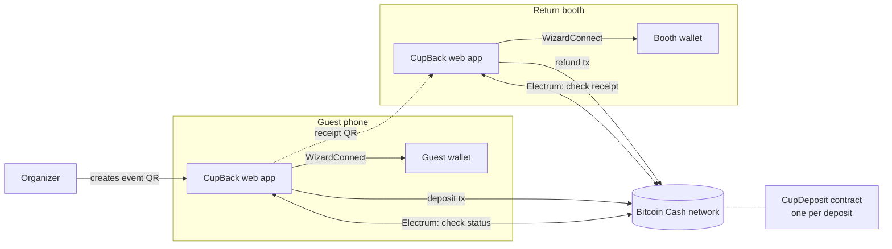
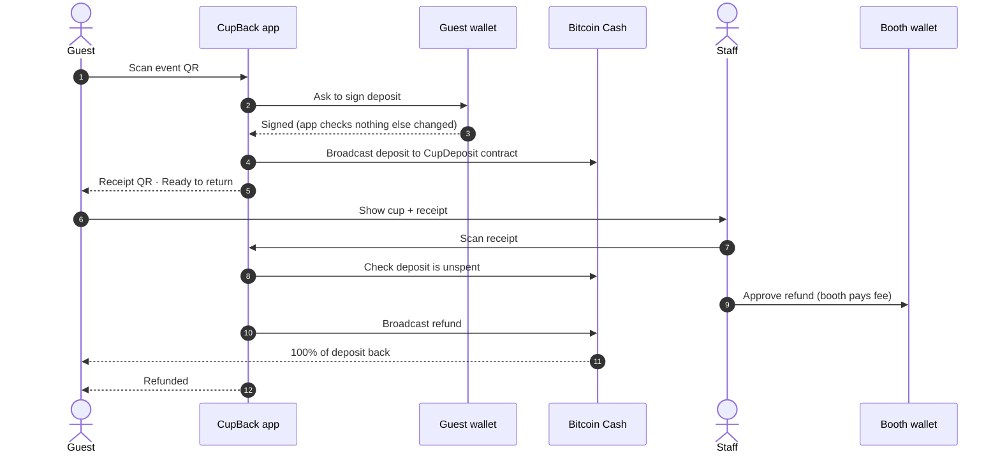
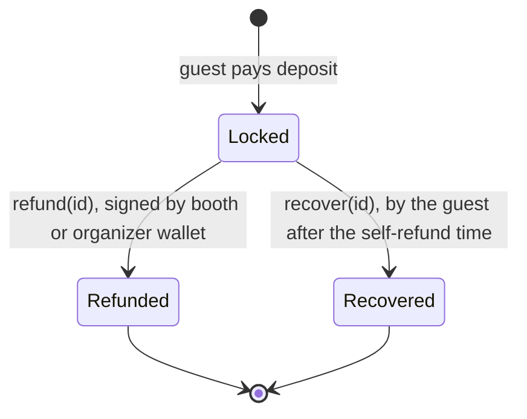

<p align="center">
  
</p>

<h1 align="center">CupBack</h1>

<p align="center"><strong>Cup deposits on Bitcoin Cash. Pay at one booth, get refunded at any booth.</strong></p>

<p align="center">
  <a href="https://cupback.vercel.app"></a>
  
  
  
  
  <a href="LICENSE"></a>
</p>

<p align="center">
  <a href="https://cupback.vercel.app/app.html">Open the app</a> ·
  <a href="https://cupback.vercel.app/app.html#solo">Try it with your wallet</a> ·
  <a href="https://cupback.vercel.app/docs.html">Docs</a> ·
  <a href="https://cupback.vercel.app/cupback-presentation.pdf">Presentation</a>
</p>

---

Guests pay a small BCH deposit when they take a reusable cup. When they bring it back, any authorized booth approves the refund and the full deposit goes back to the guest's wallet. A small contract holds each deposit, so it can only ever go back to the guest.

## The problem

Festivals, markets and stadiums are moving to reusable cups. The deposit is what brings the cups back, but today it runs on cash and plastic tokens:

- **Guests lose money.** Refunds often only work at the stall that sold the cup. Lost tokens, closed stalls or long queues mean the deposit is gone.
- **Staff handle cash.** Every return means counting change at the busiest time, plus cash floats and end-of-day counting.
- **Nobody can prove it was fair.** There is no easy way to show that every deposit was either refunded or kept by the rules.

## The solution

CupBack locks each deposit in its own on-chain contract. Any booth the organizer allows can refund it, the guest always gets 100% back, and every deposit and refund is public. No cash, no tokens, no custody.

## How it works

1. **Pay.** The guest scans the event QR code and approves the deposit in a WizardConnect wallet, such as Cashonize. They get a receipt with its own QR code.
2. **Return.** Booth staff scan the receipt, check the cup, and approve the refund. The booth wallet pays the network fee.
3. **Refunded.** The guest gets back 100% of the deposit. The receipt changes to **Refunded**.

If no booth refunds a deposit, the guest can take it back after the event's self-refund time.

## Try it

Open [the app](https://cupback.vercel.app/app.html#solo) and tap **Try it**. Your wallet plays both the guest and the booth, so one person can run the whole flow.

- You need a Bitcoin Cash wallet with WizardConnect (like Cashonize) holding at least 0.000039 BCH in one balance entry.
- The deposit is 0.00001 BCH and comes back in full. You only pay two network fees, under one US cent in total.

## Live on mainnet

Verified on November 21, 2026 with one Cashonize wallet. Both transactions are in block 978,345.

- [Deposit](https://blockchair.com/bitcoin-cash/transaction/0067f9705f54cc2dbc9821d39d48380000e081f8f9db55dccdefa7601eefa28b): 0.00001 BCH into the contract
- [Refund](https://blockchair.com/bitcoin-cash/transaction/b1e866ad97b2ccd4c496b4735e577f93692a5105e8d0963702a63441e5f9aa85): the full 0.00001 BCH back to the guest

An earlier Chipnet test used two separate wallets for the guest and the booth. See [VALIDATION.md](VALIDATION.md).

## Architecture



The app is a static site with no backend. Wallets sign through WizardConnect, and the app reads the chain through public Electrum servers. Events and receipts travel as links and QR codes.

## Deposit flow



## Deposit lifecycle



## The contract

Each deposit gets its own [`CupDeposit`](CupDeposit.cash) contract (CashScript 0.14, P2SH32). It can be spent in only two ways, and both pay the guest in full:

| Function | Who can use it | Rule |
|---|---|---|
| `refund(id)` | Booth or organizer wallet | The booth's coin must be the second input. Output 0 must pay the guest the exact deposit. |
| `recover(id)` | The guest | Only after the self-refund time. Output 0 must pay the guest the exact deposit. |

Each contract includes a random 16-byte receipt ID, so every deposit can only be refunded once.

The app also:
- rejects a signed transaction if the wallet changed anything other than its signature
- checks the receipt against the chain before staff approve
- detects when a broadcast reply is lost, so a retry cannot pay twice
- waits for the network's median block time before a self-refund, because timestamp locks run about an hour behind the clock

CupBack never holds deposits or private keys.

## Project structure

```
cupback/
├── CupDeposit.cash        # CashScript contract: refund() and recover()
├── contract.json          # compiled contract artifact (built by compile.mjs)
├── compile.mjs            # compiles CupDeposit.cash with cashc
├── chain.js               # wallet connection, deposit, refund, recovery, chain checks
├── amounts.js             # BCH amount parsing
├── src.js                 # app screens: pay, receipts, booth, events
├── landing.js             # landing page: mainnet text, proof links, BLAZE banner
├── index.html             # landing page
├── app.html               # the app
├── docs.html              # guest, staff and organizer guide
├── style.css              # all styles
├── contract.test.mjs      # contract rules tested in the BCH VM
├── amounts.test.mjs       # amount parsing tests
├── public/
│   └── cupback-presentation.pdf
├── *.svg, cashonize.png   # logo and images
├── vite.config.js         # multi-page build: landing, app, docs
├── vercel.json            # Vercel build settings
├── VALIDATION.md          # release and on-chain test checklist
├── SECURITY.md
├── CONTRIBUTING.md
├── CODE_OF_CONDUCT.md
└── LICENSE
```

## Tech stack

| Layer | Tools |
|---|---|
| Contract | CashScript 0.14 (`cashc`, `cashscript`), P2SH32 |
| Transactions | `@bitauth/libauth` |
| Wallet | WizardConnect (`@wizardconnect/core`, `@wizardconnect/dapp`) |
| Chain data | Electrum servers via CashScript's `ElectrumNetworkProvider` |
| Frontend | Plain JavaScript, HTML and CSS, built with Vite |
| QR | `qrcode` to draw, `jsqr` to scan |
| Hosting | Vercel (static) |

## Run locally

Requires Node 22.12+.

```bash
npm ci
npm run dev     # local dev server (Chipnet by default)
npm test        # contract and amount checks in the BCH VM
npm run build   # production build in dist/
```

Camera scanning and clipboard need HTTPS. Serve `dist/` over HTTPS to test them.

## Deploy

Import the repo into Vercel with Node 22.x or 24.x. `vercel.json` sets the Vite build and the `dist` output.

| Variable | Purpose |
|---|---|
| `VITE_BCH_NETWORK` | `mainnet` for real BCH. Leave unset for Chipnet. |
| `VITE_PROOF_DEPOSIT_TX`, `VITE_PROOF_REFUND_TX` | Mainnet transaction IDs shown on the landing page |
| `VITE_BLAZE_EMBER_ADDRESS` | Token-aware address shown in the BCH BLAZE banner |
| `VITE_BLAZE_PRESENTATION_URL` | Optional. Replaces the bundled presentation PDF. |

Event and receipt links only open on the domain that created them.

## Good to know

- Staff check the cup by eye. The chain checks who approves, the amount, and where the refund goes.
- After the self-refund time, a guest can take back a deposit without returning the cup. Organizers should pick that time with this in mind.
- Saved events and receipts live in each browser. Share receipts by link or QR code.
- CupBack uses public Electrum servers and the WizardConnect relay, so it needs an internet connection.
- Still to do: a mainnet self-refund test, an independent contract review, and a pilot at a real venue.

## Security

Found a security problem? Please report it privately. See [SECURITY.md](SECURITY.md).

## Contributing

Issues and pull requests are welcome. See [CONTRIBUTING.md](CONTRIBUTING.md) and our [Code of Conduct](CODE_OF_CONDUCT.md).

## BCH BLAZE 2026

CupBack is entered in the BCH BLAZE 2026 Mainnet track. [Presentation](https://cupback.vercel.app/cupback-presentation.pdf) · EMBER2026 voting address: `bitcoincash:zzfpcwe2655yg8p5w3u0mmxu46ar8hgmpc5le4uzm6`

## License

[ISC](LICENSE) © 2026 Sithu Nyein
