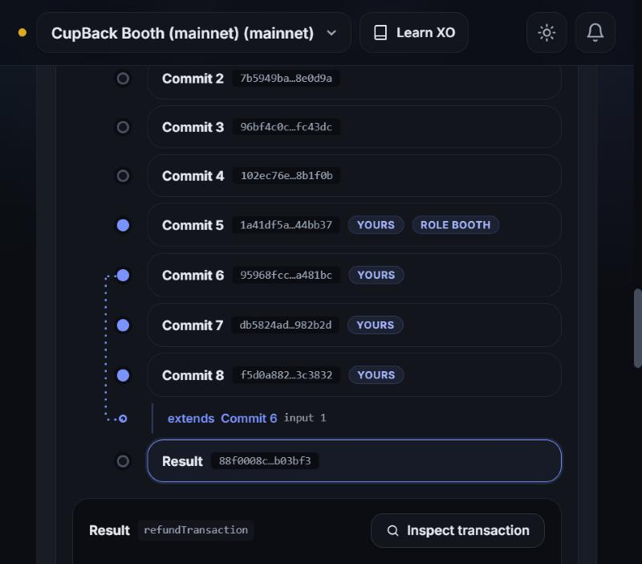
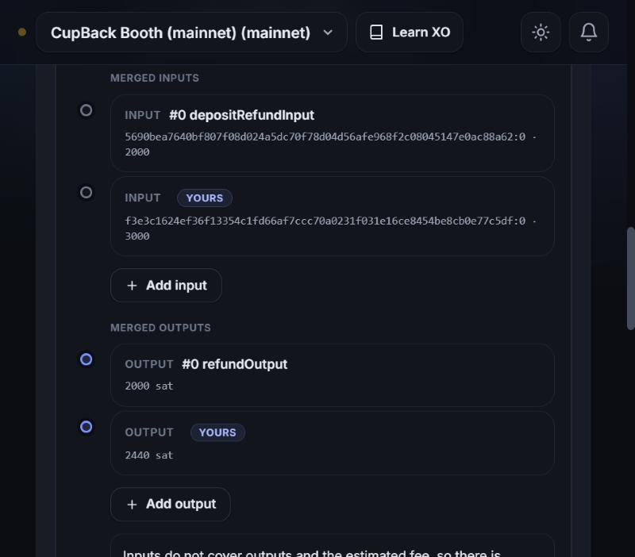
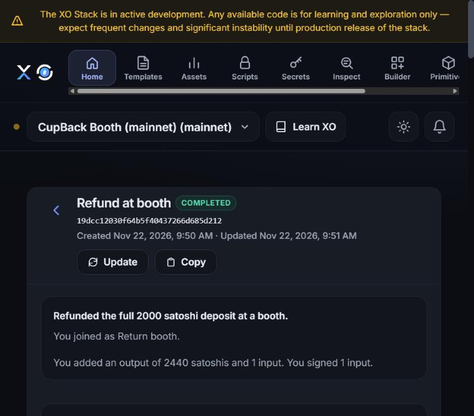

# CupBack on XO

CupBack's cup-deposit covenant, migrated from CashScript + WizardConnect to an [XO](https://stack.xo.cash) template. Any XO wallet can now pay a cup deposit, have a **separate booth wallet** approve the refund, or take the deposit back after the event.

- Original app: https://cupback.vercel.app (CashScript + WizardConnect, live on BCH mainnet)
- Original contract: [`../CupDeposit.cash`](../CupDeposit.cash) · compiled: [`../contract.json`](../contract.json)
- XO template: [`cupback.template.json`](cupback.template.json) (import this) · same template in TypeScript: [`cupback.template.ts`](cupback.template.ts)
- Template ID: `dd178bd48f3c3a12b536e0cc96ef0690e157873385d174ad1eac7c07194bf0c0`

## Headline: a real two-party refund on mainnet

Two separate XO accounts, each with its own keys:

- **Guest** wallet `bitcoincash:qpmultd9m4r594ndazs2s7skp7l5uahn8uadk4pa6f`
- **Booth** wallet `bitcoincash:qzav2kn69adm4fsajgfllcps6u6ck47k35te2xrrqs`

| Step | Who signs | Invitation | Transaction |
|---|---|---|---|
| Guest pays a 2000-sat cup deposit. The booth's address is written into the covenant as the approver. | Guest | [`5-deposit-two-party.json`](invitations/5-deposit-two-party.json) | [`5690bea7…0ac88a62`](https://blockchair.com/bitcoin-cash/transaction/5690bea7640bf807f08d024a5dc70f78d04d56afe968f2c08045147e0ac88a62) |
| Guest opens a `refund` invitation and commits the deposit input and the refund output. Booth joins from its own wallet, adds its own coin as input 1, pays the fee, signs and broadcasts. The covenant forces all 2000 sats back to the guest. | Guest, then Booth | [`6-refund-two-party.json`](invitations/6-refund-two-party.json) | [`88f0008c…97b03bf3`](https://blockchair.com/bitcoin-cash/transaction/88f0008c4d453932ce5d4f5a964285fdd4e0b66e6788755969909c6297b03bf3) |

The refund invitation has 8 signed commits from two different entities: commits 1–4 by the guest (`xpub6FQWVPn2…`), commits 5–8 by the booth (`xpub6EbAjsAc…`).

| Booth's view: the guest's deposit is input 0, the booth's own coin ("YOURS") is input 1 | Refund completed from the booth's wallet |
|---|---|
|  |  |

More screenshots: [booth joined](screenshots/2-booth-joined.jpg) · [variables the guest committed](screenshots/3-variables.jpg)

### What each role signs

| Role | Commits | Signs on chain |
|---|---|---|
| Guest | joins, the six deposit variables, the deposit input (unlocked by the covenant, no key needed), the refund output | nothing for the refund; the covenant input carries no signature |
| Return booth | joins, its fee coin, its change output | its own P2PKH coin at input 1. The covenant only accepts the refund if input 1 belongs to the booth or the organizer address |

## What the template does

| Action | Who | What happens on chain |
|---|---|---|
| `deposit` (start action) | Guest | Locks the cup deposit in a `CupDeposit` covenant output. |
| `refund` (follow-up) | Guest asks, booth approves | Spends the deposit with the booth's coin as input 1. The covenant forces output 0 to pay the guest the full deposit. The booth pays the fee. |
| `recover` (follow-up) | Guest | After the self-refund time, the guest spends the deposit back to themselves (CLTV). |

The covenant is the same compiled `CupDeposit` bytecode that the CupBack app uses (CashScript 0.14). The template rebuilds the redeem script exactly like CashScript does: the constructor arguments are pushed in reverse order (`receiptId`, `recoveryTime`, `organizerLockingScript`, `boothLockingScript`, `guestLockingScript`), followed by the contract bytecode. It is wrapped as P2SH32 by hand (`lockingType: p2s`), the same way the official `faucet.cash` template wraps its contract.

Unlocking scripts follow CashScript's function selector:

- refund: `<receiptId> <0> <redeem>`
- recover: `<receiptId> <1> <redeem>`

## Variables

| Variable | Type | Meaning |
|---|---|---|
| `depositSatoshis` | satoshis | Cup deposit (min. 1000) |
| `receiptId` | bytes (16) | Random receipt ID; makes every deposit a unique, single-use contract |
| `recoveryTime` | integer | Unix time after which the guest may self-refund |
| `guestLockingScript` | locking_script | Where the refund goes (guest P2PKH) |
| `boothLockingScript` | locking_script | Booth wallet allowed to approve refunds |
| `organizerLockingScript` | locking_script | Second wallet allowed to approve refunds (use the booth's if none) |

## All mainnet runs

| # | Action | Invitation | Transaction |
|---|---|---|---|
| 1 | `deposit` (template v1, one wallet) | [`1-deposit-v1.json`](invitations/1-deposit-v1.json) | [`7b347d2e…52fb9fc2a`](https://blockchair.com/bitcoin-cash/transaction/7b347d2e6939ba964399d1e2f3da261263c66e389da367a56c120ac52fb9fc2a) |
| 2 | `refund` of #1 (one wallet) | [`2-refund.json`](invitations/2-refund.json) | [`b4db6f23…1890afdbb`](https://blockchair.com/bitcoin-cash/transaction/b4db6f2345c6dcd2299947d09337eeb5cb7310b1c3b7c59c1d2e6611890afdbb) |
| 3 | `deposit` | [`3-deposit-v2.json`](invitations/3-deposit-v2.json) | [`0c1ab002…175aad4cf`](https://blockchair.com/bitcoin-cash/transaction/0c1ab002e30d2266dbe5b3e42c1424b2eccb469963d198255ae502c175aad4cf) |
| 4 | `recover` of #3, after `recoveryTime` (CLTV) | [`4-recover.json`](invitations/4-recover.json) | [`61e253b6…a85367e17`](https://blockchair.com/bitcoin-cash/transaction/61e253b6d4665bcf42f6f227c0d63db4328e35f553d7ff771a075a3a85367e17) |
| 5 | `deposit`, two parties | [`5-deposit-two-party.json`](invitations/5-deposit-two-party.json) | [`5690bea7…0ac88a62`](https://blockchair.com/bitcoin-cash/transaction/5690bea7640bf807f08d024a5dc70f78d04d56afe968f2c08045147e0ac88a62) |
| 6 | `refund` of #5, guest + separate booth | [`6-refund-two-party.json`](invitations/6-refund-two-party.json) | [`88f0008c…97b03bf3`](https://blockchair.com/bitcoin-cash/transaction/88f0008c4d453932ce5d4f5a964285fdd4e0b66e6788755969909c6297b03bf3) |

Runs 1–4 were the first pass, with one wallet in every role. Deposit #1 used template v1 (`5e8bb27e…67d5b4e`). v1 did not ask the guest for the deposit variables in `refund` and `recover`, so XO could not rebuild those unlocking scripts. v2 adds those requirements and nothing else. The covenant bytecode is identical, which is why the v2 refund could spend the v1 deposit.

## Reproduce

1. Open https://blaze.xo.cash and create **two** accounts, "Guest" and "Booth" (mainnet, or chipnet for test coins). In each one, go to **Settings → Defaults** and set Receive, Change and Address to **Wallet (P2PKH)**. Fund both receive addresses with a few thousand satoshis.
2. In both accounts, **Import Template** and paste [`cupback.template.json`](cupback.template.json).
3. **Guest:** **Create Invitation → CupBack → Pay cup deposit**. Use **Paste JSON** for the six variables: `guestLockingScript` is the guest's address, and `boothLockingScript` / `organizerLockingScript` are the booth's. Then **Set up output** for the deposit, **Add input** from the wallet, **Add change**, **Sign**, **Create and broadcast**.
4. **Guest:** start the refund with **Join Invitation** and `{"invitationIdentifier":"<random 32 hex>","templateIdentifier":"dd178bd48f3c3a12b536e0cc96ef0690e157873385d174ad1eac7c07194bf0c0","actionIdentifier":"refund","createdAtTimestamp":<ms>,"commits":[]}`. Join as **Guest** and paste the same variables. **Set up input** → paste the covenant locking bytecode → **Fetch UTXOs** → pick the deposit. Then **Set up output**, and **Copy** the invitation.
5. **Booth:** switch account, **Join Invitation** with the copied JSON, and choose **Return booth**. **Add input** with one booth coin, **Add change**, **Sign**, and **Create and broadcast**.
6. **Recover** (guest alone, after `recoveryTime`): same as step 4 with `"actionIdentifier":"recover"`. Input 1 must be a coin from the **guest** address (the covenant checks it). The transaction locktime is `recoveryTime`.
7. To inspect any run, **Join Invitation** with a file from [`invitations/`](invitations/), or open its transaction in **Inspect**.

## Verified: XO builds the same contract as CashScript

- `cupDepositContract` in the template is byte-for-byte the `bytecode` of [`../contract.json`](../contract.json) (cashc 0.14.0).
- Taking the redeem script out of the mainnet unlocking bytecode and hashing it with HASH256 gives exactly the covenant locking bytecode of every deposit (`aa20394c…`, `aa200dd0…`, `aa20edc8…`).
- Both spending paths passed consensus on mainnet: `refund` (booth approval, full amount forced to the guest), including with a separate booth wallet, and `recover` (CLTV after `recoveryTime`).
